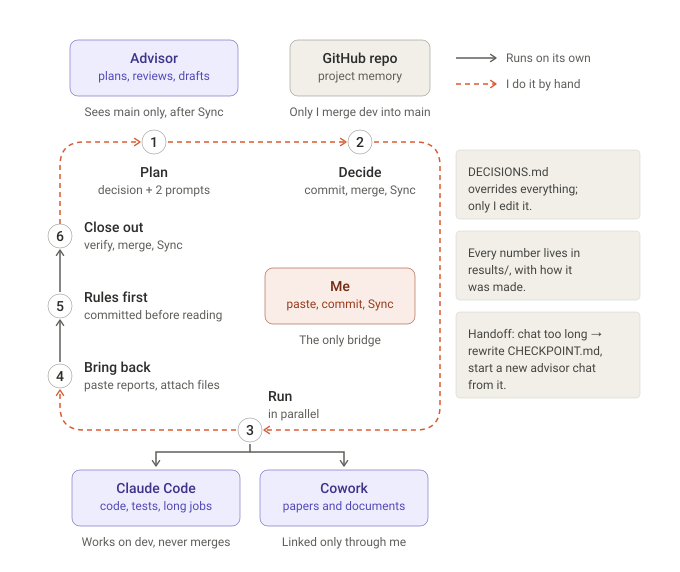

# How this project is run

This project is run by one person with three Claude tools. Nothing moves between them on its own: I am the link. I paste reports, attach files, write decisions, commit, merge and sync.

## Overview



## The parts

| Part | Where | Reads | Writes |
|---|---|---|---|
| **Me (author)** | everywhere | everything | `DECISIONS.md`, `CHECKPOINT.md`; merges `dev` → `main`; presses Sync |
| **Advisor chat** (Opus 5.5), (a Claude Project) | claude.ai | a GitHub sync of `main`, plus whatever I paste or attach | plans, reviews, decision drafts, prompts; never code or files |
| **Design chats** (Fable or Opus 5.5) (optional) | claude.ai, one new chat per design | `CHECKPOINT.md`, `DECISIONS.md`, the results they design against | full designs of a new method, committed to `design/` |
| **Claude Code** | my workstation, in this repo, on `dev` | `CLAUDE.md`, `CHECKPOINT.md`, `DECISIONS.md`, `results/SUMMARY.md`, the code | code, tests, `results/` records, phase notes; pushes `dev`, never merges |
| **Cowork** (a second Claude Project) | a local folder | its brief, `inputs/`, `papers/` | literature notes and documents in `outputs/` |

Every session names its model in its prompt and in its run record.

## Where things live

```
repo/                            Claude Code works here
├── CLAUDE.md                    rules for Claude Code
├── CHECKPOINT.md                orientation for a new advisor chat (mine; Claude Code updates "In flight")
├── DECISIONS.md                 numbered decisions; overrides every other file (mine)
├── design/                      designs and literature notes, incl. Cowork outputs worth keeping
│   └── paper/                   paper draft, references.bib, novelty checks
├── scripts/, src/, tests/       code and tests
├── results/                     every number, with the commit, command and inputs that made it
│   └── SUMMARY.md               current status and a row per run
└── outputs/<phase>/notes.md     in-flight notes (the only committed part of outputs/)
    never committed: data/, checkpoints/, third_party/, and outputs/ logs, dumps, worktrees

Cowork folder (local, outside the repo)
├── inputs/                      what I hand Cowork
├── outputs/                     what Cowork writes (e.g. paper/, scoping/)
└── papers/                      the sources it reads

Advisor Project (no folder)      knowledge = a sync of main, limited to design/, outputs/,
                                 CLAUDE.md, DECISIONS.md, CHECKPOINT.md, results/SUMMARY.md
```

## The loop

1. **Plan.** The advisor drafts the next decision and two prompts: one for Claude Code, and one self-contained brief for Cowork.
2. **Decide.** I write the decision into `DECISIONS.md`, commit, merge `dev` → `main`, and press Sync.
3. **Check.** The advisor compares the committed decision with its draft and re-checks the prompts against the repo.
4. **Run.** I start a fresh Claude Code session on `dev` with its prompt, and a Cowork task with its brief.
5. **Execute.** Claude Code writes code with synthetic tests, commits and pushes `dev`, launches long jobs detached and reports; logs go in `outputs/logs/` and PIDs in the phase notes. Cowork reads papers and writes into its `outputs/`.
6. **Bring back.** I paste both reports into the advisor chat and attach Cowork's files. Cowork outputs worth keeping are committed into `design/`.
7. **Rules first.** Before any result is read, the advisor drafts how it will be read, and I commit that as a decision.
8. **Close out.** When the jobs end, a Claude Code close-out session verifies the records independently, applies the rules, and updates `results/` and `SUMMARY.md`. I merge and Sync, and we discuss. Back to step 1.

**Handoff.** When an advisor chat gets too long, `CHECKPOINT.md` is rewritten and a new advisor chat starts by reading `CHECKPOINT.md`, then `DECISIONS.md`, then `results/SUMMARY.md`.

## Rules that hold it together

- **`DECISIONS.md` overrides every other file**, and only I edit it.
- **A number exists only in `results/`**, with the commit, exact command, data split, checkpoint, and inputs that produced it.
- **How a result will be read is decided before it is read**, and never changed afterwards.
- **Every metric is tested on synthetic data with known answers** before it touches real data.
- **Long jobs run detached** and survive the session that started them. The queue runner commits nothing.
- **Claude Code works on `dev`; only I merge to `main`.** Data, checkpoints, outputs and third-party code are never committed.
- **The advisor sees only `main`**, so merge and Sync come before every check.